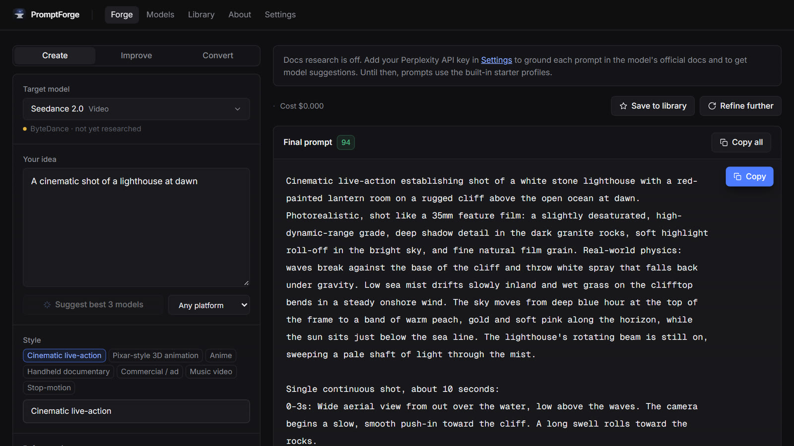
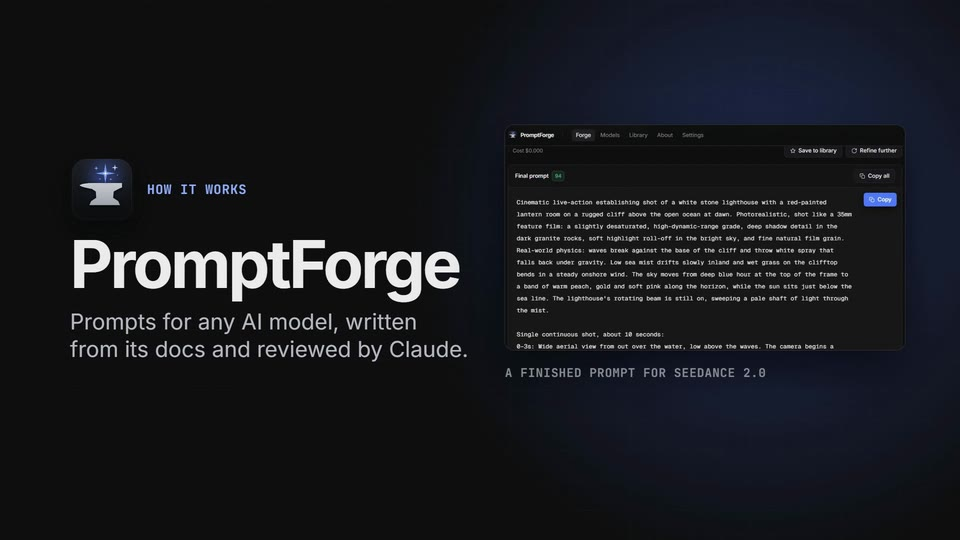
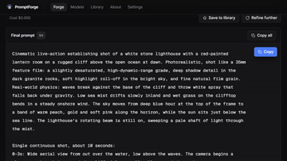
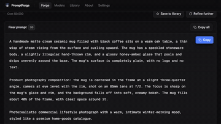
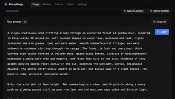
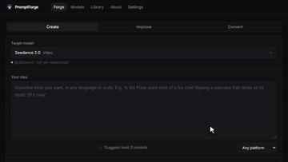
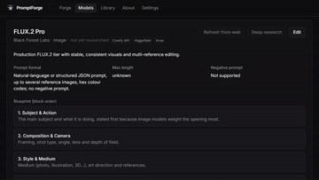
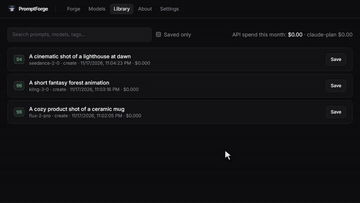

# PromptForge

Doc-grounded prompt engineering for any AI model: text LLMs, image, video, audio and 3D. Describe what you want, in
any language and with reference images if you like, pick a target model, and PromptForge writes the prompt the way
that model's official documentation says it should be written. Then a reviewer scores it against the docs and it is
revised until it passes. It is a Next.js app that runs on your computer and opens in your browser.

**Runs on your computer. Writing prompts uses your own Claude account (an Anthropic API key, or your Claude plan
through Claude Code), and the optional docs research uses your own Perplexity account and key; nothing of yours is
uploaded anywhere else.**



<!-- videos:start -->
## See it in action

<p align="center"><a href="docs/videos/tutorial.mp4"></a><br><b>▶ <a href="docs/videos/tutorial.mp4">How it works</a></b> (0:56, with captions)</p>

**Made with PromptForge, from three requests written for this page (Claude through Claude Code, docs research off)**

<table><tr>
<td width="33%" align="center"><a href="docs/videos/examples/lighthouse-seedance-2.mp4"></a><br><a href="docs/videos/examples/lighthouse-seedance-2.mp4">Seedance 2.0 · a lighthouse at dawn</a></td>
<td width="33%" align="center"><a href="docs/videos/examples/mug-flux-2-pro.mp4"></a><br><a href="docs/videos/examples/mug-flux-2-pro.mp4">FLUX.2 Pro · a ceramic mug product shot</a></td>
<td width="33%" align="center"><a href="docs/videos/examples/forest-kling-3.mp4"></a><br><a href="docs/videos/examples/forest-kling-3.mp4">Kling 3.0 · a fantasy forest animation</a></td>
</tr><tr>
<td width="33%" align="center"><a href="docs/videos/examples/model-picker.mp4"></a><br><a href="docs/videos/examples/model-picker.mp4">302 models · search and filter</a></td>
<td width="33%" align="center"><a href="docs/videos/examples/model-profile.mp4"></a><br><a href="docs/videos/examples/model-profile.mp4">A model profile · FLUX.2 Pro</a></td>
<td width="33%" align="center"><a href="docs/videos/examples/library.mp4"></a><br><a href="docs/videos/examples/library.mp4">The Library</a></td>
</tr></table>

Click any picture to play the video. The examples and the tutorial are screen recordings of PromptForge itself. The
three requests ("a cinematic shot of a lighthouse at dawn", "a cozy product shot of a ceramic mug", "a short fantasy
forest animation") were written for this page, and the prompts were written by Claude through
[Claude Code](https://code.claude.com/docs/en/setup) from the built-in starter profiles. No photos, footage or other
people's work are used.
<!-- videos:end -->

## Install

You need:
- Windows 10 or 11, x64 (it is built and tested on Windows 11)
- [Node.js](https://nodejs.org) 22 or newer
- Microsoft Edge or Google Chrome, if you want the app in its own window
- Claude, through one of these (see [Bring your own key](#bring-your-own-key)):
  an [Anthropic API key](https://platform.claude.com/settings/keys), or
  [Claude Code](https://code.claude.com/docs/en/setup) installed and logged in with your Claude plan
- Optional: a [Perplexity API key](https://console.perplexity.ai/project/keys) for docs research and model suggestions

In the app's folder:

```
npm install
npm run dev
```

Then open http://127.0.0.1:3000 and add your key on the **Settings** page.

To start it like a desktop app instead: `launch.vbs` (or `powershell -ExecutionPolicy Bypass -File launch.ps1`)
starts the server in the background on port 3777 and opens PromptForge in its own Edge or Chrome window.
`powershell -ExecutionPolicy Bypass -File make_shortcut.ps1` puts a **PromptForge** shortcut on your Desktop, and
`stop.ps1` stops the background server.

Other commands:

```
npm run build && npm start   # production build, served on http://127.0.0.1:3000
npm test                     # the tests (no network, no keys needed)
npm run lint
```

The server only listens on 127.0.0.1, so other computers on your network can't reach it.

## Bring your own key

PromptForge uses two paid services, each through **your own** account. Nothing is shared with the author or anyone
else, and each key is only ever sent to its own service.

| Service | What it does here | Needed? | Get a key | Environment variable |
|---|---|---|---|---|
| **Claude** by Anthropic | Reads your request, writes the prompt, reviews it, builds model profiles from research, ranks model suggestions | Yes, to forge prompts | [platform.claude.com](https://platform.claude.com/settings/keys) | `ANTHROPIC_API_KEY` |
| **Perplexity** | Researches each model's official docs on the web; powers **Suggest best 3 models**, **Add any model**, **Refresh from web** and **Deep research** | Optional | [console.perplexity.ai](https://console.perplexity.ai/project/keys) | `PERPLEXITY_API_KEY` |

**Where to put a key.** Paste it on the **Settings** page. It is saved on your computer only, in
`%LOCALAPPDATA%\PromptForge\settings.json`, and the app only ever shows its start and last 4 characters
(`sk-...a1b2`). You can also set the environment variable, or copy `.env.example` to `.env.local` and fill it in.
A key saved in Settings takes priority over the environment variable. Settings also has a **Remove** button.

**Claude through your Claude plan instead of an API key.** If you have a Claude plan with Claude Code, choose
**Claude Code** in Settings (or set `PF_CLAUDE_PROVIDER=claude-code`). Install it with the
[native installer](https://code.claude.com/docs/en/setup) and run `claude` once in a terminal to log in.
PromptForge then runs `claude -p` as a plain model call, with its tools, MCP servers, slash commands and settings
turned off, from an empty temporary folder, and without any `ANTHROPIC_API_KEY` in its environment, so the usage counts
against your plan's limits rather than an API bill. PromptForge looks for `claude.exe` in `%USERPROFILE%\.local\bin`
and then on your PATH; set `PF_CLAUDE_BIN` to its full path if it is somewhere else. (An npm install of Claude Code
only puts a `claude.cmd` script on the PATH, which Node can't start directly: point `PF_CLAUDE_BIN` at the real
`claude.exe` in that case.) The CLI is never used unless you choose it.

**What it costs.** You pay the services directly, at their prices.
- Claude API: by default prompts are written by Claude Opus 5.5 and the cheaper passes (reading your request,
  reviews, building profiles) use Claude Sonnet 5. At the time of writing they cost $4 / $20 and $2 / $10 per million
  input / output tokens ([pricing](https://platform.claude.com/docs/en/about-claude/pricing)). One forge makes 3 to 8 Claude calls: one to read
  your request, then up to three rounds of writing and review (Improve adds a review of your original prompt).
  PromptForge works out each forge's cost from the token counts the API returns, shows it with the result, and the
  **Library** page shows this month's total per service.
- Claude Code: no API bill; it uses your plan's usage limits.
- Perplexity: the first forge for a model (and again after 14 days) researches its docs with `sonar-pro`, usually
  in one or two requests; **Deep research** uses `sonar-deep-research`, which is slower and costs more. Perplexity
  bills per request and per token ([pricing](https://docs.perplexity.ai/docs/getting-started/pricing)); the cost it
  reports is added to the forge's cost.

**What is sent where.**
- The Anthropic key goes only to `api.anthropic.com`, in the `x-api-key` header. The app sets that host itself, so
  `ANTHROPIC_BASE_URL` is ignored, and it never falls back to other Anthropic credentials on your computer.
  Anthropic receives your request, any reference images and the target model's profile (and, when a profile is
  built, Perplexity's research notes). With Claude Code the same goes through the Claude Code CLI.
- The Perplexity key goes only to `api.perplexity.ai`, in the `Authorization` header. Perplexity receives the model's
  name, vendor and docs domains; for **Suggest best 3 models** it also receives your request, what it needs and the
  candidate model names.
- Keys are never written to logs, never put in a URL and never sent to the browser in full. The local server refuses
  requests that come from other websites or other host names, so a page you visit can't use your keys through it.

**Without keys.** Everything that doesn't need a service still works: the Models page (browse, search and edit the
302 model profiles), the Library, About and Settings. Forge says it needs Claude and links to Settings.
**Without Perplexity**, forging works from the built-in starter profiles: each model's prompt blueprint, review
checklist and docs domains, but without the rules researched from its docs. The model suggestions, **Add any model**
and **Refresh from web** are off until you add a key.

## How it works

1. **Intake**: Claude Sonnet turns your idea (any language, plus up to 6 reference images) into a precise intent.
   It asks up to 3 questions only when an answer would change the result; tick **Skip clarifying questions** to
   let it choose sensible defaults.
2. **Research**: each model has a profile. When a profile is new or older than 14 days, Perplexity researches the
   model's official docs (limited to the vendor's own domains, with an open-web retry when they say too little) and
   Claude turns the findings into a profile with cited rules, parameters, anti-patterns, a review checklist and
   examples.
3. **Compose**: Claude Opus writes the prompt block by block from the model's blueprint, most important context
   first. The video blueprint follows the Higgsfield studio structure: scene context and style, active references,
   shot structure, locks, animation principles, audio.
4. **Critique**: a separate reviewer scores the prompt against the doc checklist and lists concrete fixes. Below 90
   it is revised, up to two more rounds, and the best version is kept.

Modes:
- **Create**: from an idea.
- **Improve**: scores an existing prompt against the model's docs, then rewrites it.
- **Convert**: translates a prompt written for one model (for example Midjourney) into another model's documented
  format (for example Flux).

Also:
- **Suggest best 3 models**: analyses what your request needs, researches current comparisons and benchmarks, and
  ranks the three best models in the catalog for it, optionally only those on one platform.
- **Models**: 302 starter profiles for text, image, video, audio and 3D models, tagged by where you can use them
  (ComfyUI open weights, the ComfyUI Partner API, Krea, Higgsfield). Open any profile to see its blueprint, rules and
  sources, refresh it from the web, run a deep research, or edit it as JSON. **Add any model** researches a model
  that isn't in the catalog yet.
- **Library**: every forged prompt is kept with its score and cost. Search, star, title and tag them.
- The result view shows the final prompt (copy it with one click), the negative prompt and settings when the model
  has them, the block-by-block breakdown with the documented reason for each block, the checks it passed and the
  sources it is grounded in.

No prompt can guarantee an exact output, because generative models are probabilistic. PromptForge keeps each prompt
faithful to the model's current docs and removes ambiguity; for important work, generate several takes and use
**Refine further**.

## Settings and environment variables

| Variable | What it does |
|---|---|
| `ANTHROPIC_API_KEY`, `PERPLEXITY_API_KEY` | Your keys, if you don't save them in Settings |
| `PF_CLAUDE_PROVIDER` | `api` (the default) or `claude-code`; the choice in Settings wins |
| `PF_CLAUDE_BIN` | Full path to the Claude Code executable |
| `PF_WRITER_MODEL`, `PF_FAST_MODEL` | Claude models for writing (default `claude-opus-5-5`) and for intake, review and profiles (default `claude-sonnet-5`) |
| `PF_RESEARCH_MODEL`, `PF_DEEP_RESEARCH_MODEL` | Perplexity models (default `sonar-pro` and `sonar-deep-research`) |
| `PROMPTFORGE_DATA_DIR` | Use this folder for the database and settings instead of `%LOCALAPPDATA%\PromptForge` |

`next dev` and `next build` send anonymous usage data to Next.js unless `NEXT_TELEMETRY_DISABLED=1` is set
(`launch.ps1` sets it). The first build or dev start downloads the Inter and Geist Mono fonts from Google Fonts
(through `next/font`); they are then served by the app itself.

## What's where
- `src/app/`: the pages (Forge, Models, Library, About, Settings) and the API routes under `src/app/api/`
  (`forge` and `recommend` stream progress as newline-delimited JSON; `profiles`, `library`, `settings`, `stats`).
- `src/components/`: the interface. `Forge.tsx` is the main screen, `Settings.tsx` the key settings.
- `src/lib/settings.ts`: your keys and choices: where they come from (Settings or environment), masking, and the
  data folder. `src/lib/local-only.ts`: refuses requests from other sites and host names.
- `src/lib/llm/`: the service clients: `claude.ts` (Anthropic API, structured JSON output, cost per call),
  `claude-code.ts` (the Claude Code CLI in headless mode) and `perplexity.ts`.
- `src/lib/pipeline/`: `forge.ts` (intake, compose, critique, revise), `research.ts` (docs research and profiles)
  and `recommend.ts` (model suggestions).
- `src/lib/prompts/`: the app's own system prompts, kept byte-stable so prompt caching works.
- `src/lib/profiles/`: `catalog.json` (the starter catalog) and `seeds.ts` (blueprints and checklists per
  category). `src/lib/types.ts`: the schemas. `src/lib/db.ts`: the SQLite database.
- `tests/`: the tests.
- `assets/`: the icon (`promptforge.png`, `promptforge.ico`, `promptforge-app.ico`) and `make_icon.py`, which draws
  it (needs Python and Pillow; writes `assets/` and `src/app/icon.png`).
- `launch.ps1`, `launch.vbs`, `stop.ps1`, `make_shortcut.ps1`: start, stop and the Desktop shortcut.
- Your data: `%LOCALAPPDATA%\PromptForge\` holds `promptforge.db` (profiles, history and spend, created empty on
  first start), `settings.json` (your keys and choices) and `server.log` (when started with `launch.ps1`). On macOS
  it is `~/Library/Application Support/PromptForge`, on Linux `~/.local/share/PromptForge`.

## Tests

```
npm test
```

The tests check the starter catalog (every profile validates, ids are unique, every category and platform is
covered, the video blueprint order), the structured-output schemas, and the key handling: no key means the feature is
off and no request is made; keys are saved only in the data folder and never returned in full; a saved key wins over
the environment; the Anthropic key goes only to `api.anthropic.com` in `x-api-key` (even with `ANTHROPIC_BASE_URL`
or `ANTHROPIC_AUTH_TOKEN` set) and the Perplexity key only to `api.perplexity.ai` in `Authorization`; rejected keys
give a plain message; docs research is skipped without Perplexity; and the Claude Code provider runs the CLI without
tools, settings or an API key. Network calls are faked and the Claude Code CLI is replaced by a fake process, so the
tests never reach a real service or spend anything.

## Credits
- [Next.js](https://nextjs.org/), [React](https://react.dev/) and [Tailwind CSS](https://tailwindcss.com/) (MIT).
- The [Anthropic TypeScript SDK](https://github.com/anthropics/anthropic-sdk-typescript) (MIT),
  [better-sqlite3](https://github.com/WiseLibs/better-sqlite3) (MIT) and [Zod](https://zod.dev/) (MIT).
- The fonts [Inter](https://rsms.me/inter/) and [Geist Mono](https://vercel.com/font) (SIL Open Font License 1.1),
  through `next/font`.
- Model, vendor and platform names in the catalog belong to their owners. PromptForge is an independent project, not
  affiliated with Anthropic, Perplexity or any model vendor or platform.
- Examples, screenshot and tutorial video in `docs/`: screen recordings of PromptForge. The prompts in them were
  written by Claude, through [Claude Code](https://code.claude.com/docs/en/setup), from three requests written for this
  README; docs research was off, so they use the built-in starter profiles.

## Licence

MIT, see [LICENSE](LICENSE).
